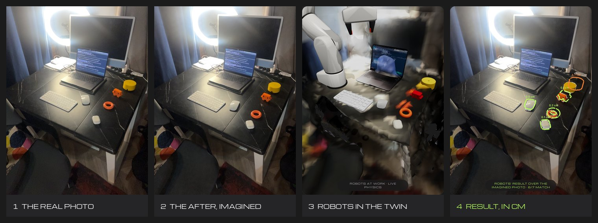
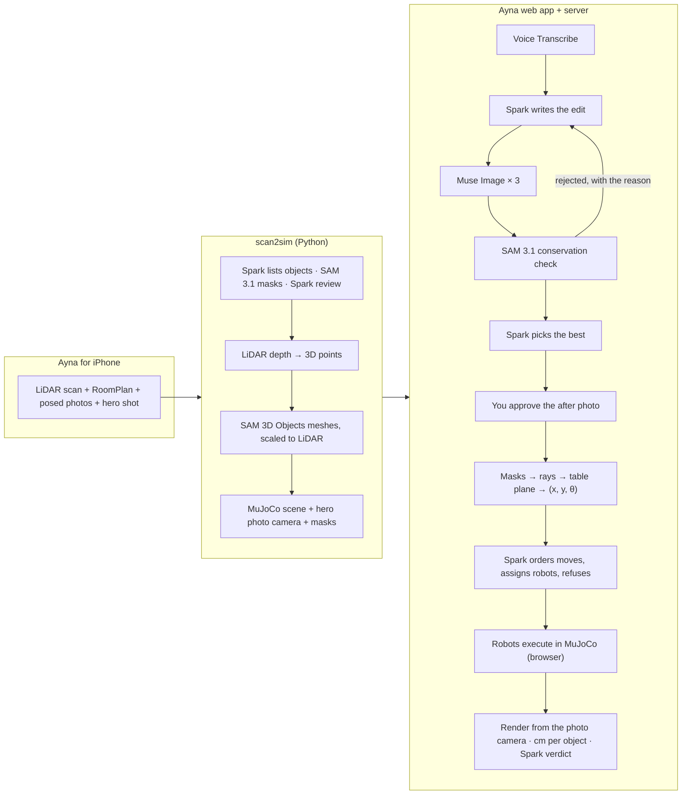

<p align="center">
  
</p>

<p align="center">
  Say how your table should look. Ayna develops the <b>after photo</b> of <i>your</i> table, checks that
  nothing in it vanished or changed size, turns it into centimetre goals, has robots carry it out in a
  physics twin of your room, and hands you a receipt: where every object ended up, in centimetres.
</p>

<p align="center">
  <a href="https://ayna-brown.vercel.app/app/"><b>Live demo</b></a> ·
  <a href="https://ayna-brown.vercel.app/">Landing page</a> ·
  <a href="https://ayna-brown.vercel.app/app/?autoplay">One-take replay</a> ·
  Video (3 min): <i>coming November 3</i>
</p>



*A real run on a scanned desk: the hero photo, Muse Image's approved after photo (versions that lost an
object were rejected by SAM 3.1), the arm moving the objects in MuJoCo, and the robots' result drawn over
the imagined photo with the error of every object.*

## Why

"Tidy my desk" hides a hundred decisions, and nobody wants a robot touching their things blind. People
already share plans as pictures; Ayna makes the picture the interface. The after photo is the plan you
approve before anything moves, and the goal image that goal-conditioned robot planners (Meta's
V-JEPA 2-AC, FAIR's RoboJEPA) need but cannot get in a stranger's home. Every scan + after photo +
automatic check is also a ready evaluation episode for a robot policy in a real home. More in
[docs/why-ayna.md](docs/why-ayna.md).

## Meta models: what each one does

| Model | Where | Its job in the loop |
|---|---|---|
| **Muse Voice Transcribe** `muse-voice-transcribe-1.0` | `web/server/meta.ts` | Push-to-talk request (English or Russian) from a 16 kHz WAV recorded in the browser |
| **Muse Spark** `muse-spark-1.3` | `web/server/ayna.ts`, `pipeline/…/discovery.py`, `verify.py` | Writes the edit instruction for this photo from the scene (objects, sizes, robot reach); judges the versions that pass; orders the moves and assigns robots with honest refusals; says in words whether the result matches. In the scan pipeline it lists the objects and reviews SAM's crops |
| **Muse Image** `muse-image-1.0` | `web/server/meta.ts` | Develops 3 versions of the after photo in parallel by editing the real hero photo (same camera, same lighting) |
| **SAM 3.1** `sam-3.1` | `web/server/meta.ts`, `pipeline/…/segmentation.py` | Finds every scanned object in the real photo and in each version; the conservation check rejects versions where an object vanished, appeared or changed size; the after masks become metric goals |
| **SAM 3D Objects** (open weights, hosted on fal) | `pipeline/…/reconstruct.py` | A full 3D mesh and pose for every object mask; placed on the LiDAR points and simulated as a body |

Remove any of them and the loop breaks: there is no goal without Muse Image, no trusted goal without
SAM 3.1, no plan without Spark, and no objects to move without SAM 3D.

## How it works



- **One frame for photo and twin.** The bundle carries the hero photo's exact pinhole camera in the
  world frame, so the three.js camera can sit where the iPhone was: the twin lines up with the photo
  pixel for pixel, the camera flies out of the photo into 3D and back, and the verifier renders the
  simulation from the same camera.
- **Goals in centimetres.** Each object's after mask is cast onto its table plane; the offset between a
  mask's centre and the body's centre, measured on the real photo, is carried over to the imagined one.
  Rotation comes from the mask's principal axis.
- **Plans are checked, not trusted.** Spark's order and robot assignment are validated against each
  robot's reach and gripper; objects that block another object's target move first.
- **Receipt.** An object matches when it rests within **3 cm** of its goal (and within 15° when it has a
  clear long axis). 3 cm is half the smallest object on our desks; Meta's Habitat "tidy house" uses 15 cm
  at room scale.

## Robots

Both robots are ours: kinematics follow published numbers, the MJCF, shells, gripper and controllers are
written here (`pipeline/src/scan2sim/arm.py`, `mobile.py`, `robots.py`; `web/src/sim/`).

- **Stationary arm:** 7 joints with the Franka Emika Panda's published modified-DH layout (reach 0.28–0.76 m
  for top-down grasps), hull shells built in code, a parallel gripper that opens to 11 cm and squeezes
  with 20 N, damped least-squares IK. Its base is a MuJoCo mocap body, so it can be dragged anywhere on
  the table without rebuilding the scene.
- **Mobile manipulator:** a round holonomic base (x, y, yaw), a lift that puts the arm base anywhere from
  0.40 to 1.00 m, and the same arm with a 16 cm gripper. It plans on a 5 cm occupancy grid of the RoomPlan
  walls and furniture (A*, inflated by its radius), parks where the arm reaches the target, lifts to
  the surface and grasps. On the desk it takes the 10.8 cm yellow cylinder that is out of the arm's
  reach and wider than its gripper.
- **One interface** (`web/src/sim/robot.ts`): `reachOf(object)` answers instantly with a reason ("0.77 m
  away, reach 0.76 m"), `run({ object, x, y, yawDelta })` does a whole pick and place, `setBasePose` moves
  a robot. Muse Spark assigns each move to a robot that reaches both ends and refuses the rest.
- **Physics choices:** elliptic friction cones, a no-slip pass and rolling friction on the pads keep round
  objects in the grip; robots collide with walls, tables and objects but not with RoomPlan furniture
  boxes (a chair's box includes the air around its backrest).

## Numbers

<!-- numbers:start -->
Numbers are filled from `.night`-style eval logs by `npm run eval`; see the table below.
<!-- numbers:end -->

## Try it

- **Guest:** open the [live demo](https://ayna-brown.vercel.app/app/) and replay a saved run (free, no model
  calls: the models' outputs come from the run record and the robots re-run in the twin).
- **Live:** sign in (judges: credentials are in the submission form) → open a mirror → hold the mic or type
  "tidy up my desk" → watch the models work → drag the before/after slider → **Do it**.
- **One take for video:** [`/app/?autoplay`](https://ayna-brown.vercel.app/app/?autoplay) replays the best
  run of the demo mirror without clicks.

## Quick start

```sh
git clone https://github.com/sabr2007/meta-global-hackathon && cd meta-global-hackathon
cp .env.example .env            # META_API_KEY, FAL_KEY, AUTH_SECRET (see the file)
```

**Scan → twin (Python, [uv](https://docs.astral.sh/uv/))**

```sh
cd pipeline && uv sync
uv run scan2sim objects ~/Downloads/Mirror.zip --cache ../data/cache/mirror --out ../data/scenes/mirror
uv run pytest
```

`scan2sim objects` runs Spark + SAM 3.1 + review, lifts masks with LiDAR depth, gets SAM 3D meshes from fal
(one request for all masks), places them, and writes the bundle: `scene.xml` (MJCF), `scene.json`,
`room_mesh.glb`, `objects/*.glb`, `hero.jpg`, `masks.json`. `--cache` keeps every paid result, so rebuilds
are free (~5 s).

**Web app + API (Node 22+)**

```sh
cd web && npm install
npx tsx scripts/seed.ts --owner you@example.com:a-long-password \
  --scan desk="Desk" --demo desk          # accounts + scans into ../data/store (or Vercel Blob)
npm run dev                              # http://localhost:5190/app/ (the API runs in the same server)
npm test && npm run build
npm run eval -- --scan desk --request "Tidy up the table"   # one headless run: live models, MuJoCo in Node
```

**iPhone app** (Xcode 27, `brew install xcodegen`)

```sh
cd ios && xcodegen generate
xcodebuild -project Ayna.xcodeproj -scheme Ayna -configuration Release \
  -destination 'generic/platform=iOS' -derivedDataPath build -allowProvisioningUpdates build
```

**Deploy:** `cd web && vercel deploy --prod` (one Vercel Function serves `/api`; scans and runs live in a
private Vercel Blob store; set `META_API_KEY`, `META_API_BASE`, `AUTH_SECRET`, `AYNA_DEMO_SCAN` with
`vercel env add`).

## Repository

```
pipeline/   scan2sim (Python): capture parser, RoomPlan → colliders, Spark + SAM 3.1 perception,
            LiDAR lifting, SAM 3D placement, our robot arm (MJCF), hero photo camera, bundle export
web/        Ayna (TypeScript): app (src/app), loop logic shared by browser and Node (src/ayna),
            MuJoCo WASM physics and robot controllers (src/sim), three.js rendering (src/render),
            server (server/: Meta model proxy, accounts, private storage), Vercel entry (api/)
ios/        Ayna for iPhone: LiDAR scanner, hero shot, Send to Ayna
docs/       why-ayna.md, images
```

Privacy: captures are photos of a real home. `data/` (scans, caches, local store) is git-ignored; the
deployed app reads scans from a private store through one-hour signed URLs.

## Limitations and honest failures

- One hero photo per table: objects outside it are not in the twin.
- Muse Image moves things modestly and sometimes drops or duplicates a small object; that is what the
  SAM 3.1 check is for, and in our runs it rejects about half of the versions (see Numbers).
- Our parallel gripper opens to 11 cm, so the laptop, the keyboard and the 10.8 cm yellow cylinder are
  refused by the stationary arm.
- Transparent objects (a clear bottle) are badly measured by LiDAR.
- The iPhone upload path was tested in the iOS simulator against the API contract, not yet on a device.

## Hackathon rules and what is new

Everything in this repository was written during the Meta Global AI Developer Hackathon (from October 26,
2026), with one exception: the iPhone capture engine in `ios/` starts from the open-source
[3D Model Anything](https://github.com/wesbos/3d-model-anything) app by Wes Bos (MIT), imported verbatim in
one commit and changed since. [NEW_WORK.md](NEW_WORK.md) separates the two in detail.

- **Models at runtime:** only Meta models (Muse Spark, Muse Image, SAM 3.1, Voice Transcribe; SAM 3D
  Objects as Meta open weights on fal). No other LLM, vision, speech or image model is called.
- **Robot reference:** the arm's kinematics are the published Franka Emika Panda modified-DH values; no
  robot model files (Franka, MuJoCo Menagerie or other) are used.
- **Dependencies** (installed by package managers): MuJoCo (Apache-2.0, `mujoco`, `@mujoco/mujoco`),
  three.js (MIT), Vite, Vitest, TypeScript, tsx (MIT), `@meta-sam/parser` and `meta-sam-parser` (Meta, SAM
  License), `@vercel/blob` (Apache-2.0), numpy, scipy, trimesh, Pillow, httpx, openai, fal-client,
  fast-simplification, python-dotenv, pytest. Fonts: Michroma and Doto (SIL Open Font License 1.1, licences
  in `web/src/styles/fonts/` and `ios/Ayna/Fonts/`). Video: [Remotion](https://www.remotion.dev/) (free for
  individuals and teams of up to 3).

## License

[MIT](LICENSE). The imported 3D Model Anything code keeps its MIT licence
([`ios/LICENSE-3d-model-anything`](ios/LICENSE-3d-model-anything)).
