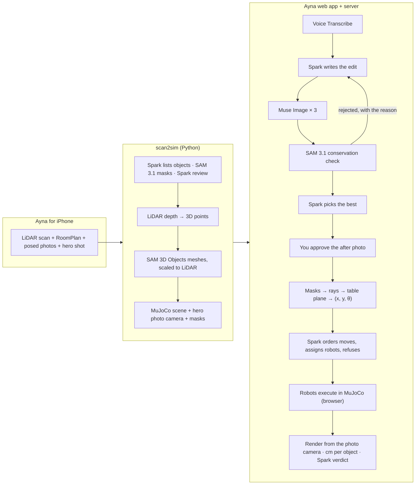

<p align="center">
  
</p>

<p align="center">
  Say how your table should look. Ayna develops the <b>after photo</b> of <i>your</i> table, checks that
  nothing in it vanished or changed size, turns it into centimetre goals, has robots carry it out in a
  physics twin of your room, and hands you a receipt: where every object ended up, in centimetres.
</p>

<p align="center">
  <a href="https://ayna-brown.vercel.app/app/"><b>Live demo</b></a> ·
  <a href="https://ayna-brown.vercel.app/">Landing page</a> ·
  <a href="https://ayna-brown.vercel.app/app/?autoplay">One-take replay</a> ·
  Video (3 min): <i>coming November 3</i>
</p>


*A real run on a scanned desk: the hero photo, Muse Image's approved after photo (versions that lost an
object were rejected by SAM 3.1), the arm moving the objects in MuJoCo, and the robots' result drawn over
the imagined photo with the error of every object.*

## Why

"Tidy my desk" hides a hundred decisions, and nobody wants a robot touching their things blind. People
already share plans as pictures; Ayna makes the picture the interface. The after photo is the plan you
approve before anything moves, and the goal image that goal-conditioned robot planners (Meta's
V-JEPA 2-AC, FAIR's RoboJEPA) need but cannot get in a stranger's home. Every scan + after photo +
automatic check is also a ready evaluation episode for a robot policy in a real home, and
`web/scripts/policies.ts` already scores robot variants on them ([Numbers](#numbers)). More in
[docs/why-ayna.md](docs/why-ayna.md).

## Meta models: what each one does

| Model | Where | Its job in the loop |
|---|---|---|
| **Muse Voice Transcribe** `muse-voice-transcribe-1.0` | `web/server/meta.ts` | Push-to-talk request (English or Russian) from a 16 kHz WAV recorded in the browser |
| **Muse Spark** `muse-spark-1.3` | `web/server/ayna.ts`, `pipeline/…/discovery.py`, `verify.py` | Writes the edit instruction for this photo from the scene (objects, sizes, robot reach); judges the versions that pass; orders the moves and assigns robots with honest refusals; says in words whether the result matches. In the scan pipeline it lists the objects and reviews SAM's crops and, with `--physics`, estimates each object's mass and friction |
| **Muse Image** `muse-image-1.0` | `web/server/meta.ts` | Develops 3 versions of the after photo in parallel by editing the real hero photo (same camera, same lighting) |
| **SAM 3.1** `sam-3.1` | `web/server/meta.ts`, `pipeline/…/segmentation.py` | Finds every scanned object in the real photo and in each version; the conservation check rejects versions where an object vanished, appeared or changed size; the after masks become metric goals |
| **SAM 3D Objects** (open weights, hosted on fal) | `pipeline/…/reconstruct.py` | A full 3D mesh and pose for every object mask; levelled, matched to its silhouette in the photo, placed on the LiDAR points (or on the table when LiDAR sees through it), painted with the photo's colours and simulated as a body |

Remove any of them and the loop breaks: there is no goal without Muse Image, no trusted goal without
SAM 3.1, no plan without Spark, and no objects to move without SAM 3D.

## How it works



- **One frame for photo and twin.** The bundle carries the hero photo's exact pinhole camera in the
  world frame, so the three.js camera can sit where the iPhone was: the twin lines up with the photo
  pixel for pixel, the camera flies out of the photo into 3D and back, and the verifier renders the
  simulation from the same camera.
- **Goals in centimetres.** Each object's after mask is cast onto its table plane; the offset between a
  mask's centre and the body's centre, measured on the real photo, is carried over to the imagined one.
  Rotation comes from the mask's principal axis.
- **Plans are checked, not trusted.** Spark's order and robot assignment are validated against each
  robot's reach and gripper; objects that block another object's target move first.
- **Receipt.** An object matches when it rests within **3 cm** of its goal (and within 15° when it has a
  clear long axis); 3 cm is half the smallest object on our desks, Meta's Habitat "tidy house" uses 15 cm
  at room scale. The score is *requested moves done × objects left in place*, so a refused or failed move
  always costs points. Positions are checked against the goals the robots were sent to; the independent
  check is how well the twin, rendered from the photo's camera, overlaps the imagined photo's masks.
- **Closing the loop.** A slipped grasp is retried once; objects still off goal get a second plan from
  where they are now.

## Robots

Both robots are ours: kinematics follow published numbers, the MJCF, shells, gripper and controllers are
written here (`pipeline/src/scan2sim/arm.py`, `mobile.py`, `robots.py`; `web/src/sim/`).

- **Stationary arm:** 7 joints with the Franka Emika Panda's published modified-DH layout (reach 0.28–0.76 m
  for top-down grasps), hull shells built in code, a parallel gripper that opens to 11 cm and squeezes
  with 20 N, damped least-squares IK. Its base is a MuJoCo mocap body, so it can be dragged anywhere on
  the table without rebuilding the scene.
- **Mobile manipulator:** a round holonomic base (x, y, yaw), a lift that puts the arm base anywhere from
  0.40 to 1.00 m, and the same arm with a 16 cm gripper. It plans on a 5 cm occupancy grid of the RoomPlan
  walls and furniture (A*, inflated by its radius), parks where the arm reaches the target, lifts to
  the surface and grasps. It takes what the arm cannot: objects wider than the arm's 11 cm gripper (the
  keyboard) and goals outside the arm's reach band, e.g. the far corner of the desk.
- **One interface** (`web/src/sim/robot.ts`): `reachOf(object)` answers instantly with a reason ("0.77 m
  away, reach 0.76 m"), `run({ object, x, y, yawDelta })` does a whole pick and place, `setBasePose` moves
  a robot. Muse Spark assigns each move to a robot that reaches both ends and refuses the rest.
- **Physics choices:** elliptic friction cones, a no-slip pass and rolling friction on the pads keep round
  objects in the grip; robots collide with walls, tables and objects but not with RoomPlan furniture
  boxes (a chair's box includes the air around its backrest).

## Numbers

<!-- numbers:start -->
**Scan → twin quality** (`uv run scan2sim report <bundle>`, medians over the objects of each scene; before = the
pipeline at the start of the night, after = now):

| | Desk (7 objects) before → after | Mirror-02 (6 objects) before → after |
|---|---|---|
| Mesh silhouette vs SAM mask, seen from the photo camera (IoU) | 0.55 → **0.93** | 0.65 → **0.86** |
| Size across the line of sight vs LiDAR | 1.23 → **1.06** | 1.21 → **1.09** |
| Tilt against the table | 2.9° → **0.0°** | 4.0° → **0.0°** |
| Drift in the first 2 s of physics | 0.71 → **0.32 cm** | 0.84 → **0.34 cm** |
| Colour difference vs the photo (ΔE) | 15.3 → **2.9** | 11.7 → **1.6** |

The ring's hole stays open (a ring of convex pieces instead of one hull), the clear bottle no longer tips
over (5.2 → 0.5 cm), and masses and friction come from Muse Spark with a one-line reason per object.

**The loop** (live Meta models through the deployed API, robots in MuJoCo, the app's own verifier;
`npm run eval`):
| Scene | Request | After photo | Versions rejected by SAM 3.1 | Moves done / asked | Score | Median error of moved objects | Time | Cost |
|---|---|---|---|---|---|---|---|---|
| Desk | Tidy up the table | approved | 5/6 | 5/7 | 71 | 0.2 cm | 102 s | $0.13 |
| Desk | Clear the front half of the table | approved | 2/3 | 4/5 | 80 | 1.1 cm | 73 s | $0.09 |
| Desk | Put all the small things together in one corner | approved | 0/3 | 5/6 | 83 | 0.2 cm | 64 s | $0.10 |
| Desk | Line the small objects up along the back edge | approved | 2/3 | 5/5 | 100 | 0.3 cm | 59 s | $0.08 |
| Desk | Move the yellow cylinder to the front right corner of the table | approved | 2/3 | 1/1 | 100 | 0.8 cm | 34 s | $0.06 |
| Desk | “tidy up my desk and put the mouse next to the keyboard.” (spoken, as Voice Transcribe heard it) | approved | 2/3 | 4/4 | 100 | 0.8 cm | 61 s | $0.07 |
| Desk | Spoken in Russian: “tidy up the table and put the mouse next to the keyboard” (Voice Transcribe) | approved | 2/3 | 5/5 | 100 | 0.2 cm | 45 s | $0.07 |
| Mirror 02 | Tidy up the table | approved | 3/6 | 4/4 | 50 | 0.1 cm | 87 s | $0.13 |
| Mirror 02 | Clear the front half of the table | approved | 0/3 | 1/1 | 80 | 0.6 cm | 45 s | $0.08 |
| Mirror 02 | Put all the small things together in one corner | approved | 4/5 | 4/4 | 50 | 0.1 cm | 102 s | $0.12 |
| Mirror 02 | Line the small objects up along the back edge | approved | 6/6 | 3/5 | 0 | 1.7 cm | 76 s | $0.12 |
| Mirror 02 | Spoken in Russian: “gather the pen, the spoon and the calculator on one side of the table” (Voice Transcribe) | approved | 1/3 | 2/3 | 67 | 0.3 cm | 60 s | $0.08 |

Final round, final code: 12 runs, 12 with an approved after photo; SAM 3.1 rejected 29 of 47 versions; 43 of 50 requested moves ended within 3 cm of the goal; mean score 73; mean 67 s and $0.09 per run.
All 56 runs on Desk tonight, every round and every version of the code: 144/215 requested moves done, 5 stopped with no approved after photo, 8 scored 0.
All 28 runs on Mirror 02 tonight, every round and every version of the code: 41/80 requested moves done, 7 stopped with no approved after photo, 5 scored 0.
Every round, its failures and what each one taught us: [docs/eval-log.md](docs/eval-log.md).

**Robot policies on the saved episodes** (`npx tsx scripts/policies.ts --scan desk-sam3d`, no model calls): every saved
run with an approved after photo replayed with the same robots and plan, but a different idea of where
each object is when the robot reaches for it; scored by the same verifier.

| Scene | Policy | Episodes | Requested moves done | Objects left in place | Mean score | Median error of moved objects | Slipped grasps |
|---|---|---|---|---|---|---|---|
| Desk | exact simulator poses | 37 | 106/148 | 110/111 | 70 | 0.7 cm | 0 |
| Desk | only the photo (SAM 3.1 mask centres) | 37 | 105/148 | 110/111 | 70 | 0.8 cm | 0 |
| Desk | exact + 1 cm error | 37 | 99/148 | 110/111 | 67 | 1.6 cm | 3 |
| Desk | exact + 2 cm error | 37 | 64/148 | 110/111 | 44 | 4.7 cm | 30 |
<!-- numbers:end -->

## Try it

- **Guest:** open the [live demo](https://ayna-brown.vercel.app/app/) and replay a saved run (free, no model
  calls: the models' outputs come from the run record and the robots re-run in the twin).
- **Live:** sign in (judges: credentials are in the submission form) → open a mirror → hold the mic or type
  "tidy up my desk" → watch the models work → drag the before/after slider → **Do it**.
- **One take for video:** [`/app/?autoplay`](https://ayna-brown.vercel.app/app/?autoplay) replays the demo
  mirror's featured run without clicks ("Put all the small things together in one corner": SAM 3.1 rejected
  four of six versions, five objects move, 5 of 5 done). Any saved run plays the same way with
  `?autoplay#/scan/<owner>/<scan>/run/<run>`.

## Quick start

```sh
git clone https://github.com/sabr2007/meta-global-hackathon && cd meta-global-hackathon
cp .env.example .env            # META_API_KEY, FAL_KEY, AUTH_SECRET (see the file)
```

**Scan → twin (Python, [uv](https://docs.astral.sh/uv/))**

```sh
cd pipeline && uv sync
uv run scan2sim objects ~/Downloads/Mirror.zip --cache ../data/cache/mirror --out ../data/scenes/mirror
uv run pytest
```

`scan2sim objects` runs Spark + SAM 3.1 + review, lifts masks with LiDAR depth, gets SAM 3D meshes from fal
(one request for all masks), places them, and writes the bundle: `scene.xml` (MJCF), `scene.json`,
`room_mesh.glb`, `objects/*.glb`, `hero.jpg`, `masks.json`. `--cache` keeps every paid result, so rebuilds
are free (~7 s). `--physics` adds Muse Spark's mass and friction per object (one call, cached too).
`uv run scan2sim report ../data/scenes/mirror --capture ~/Downloads/Mirror.zip --photo 0036` grades every
object against the capture: LiDAR distance, size against the LiDAR extents, tilt, drift in the first 2 s of
physics, colour difference from the photo, photo IoU, how open a ring's hole stays, and mass.

**Landing page and film**

The landing (`web/index.html`, `web/src/landing/`) is built from real runs: `node scripts/landing-numbers.mjs`
refreshes its numbers from the eval log. The film is a [Remotion](https://www.remotion.dev/) composition
(`video/`) made from a saved run's real photos, masks and verdicts: `cd video && npm install && npm run render`
writes `web/public/landing/ayna-loop.mp4`. `AynaDemo` is the skeleton of the 3-minute video.

**Web app + API (Node 22+)**

```sh
cd web && npm install
npx tsx scripts/seed.ts --owner you@example.com:a-long-password \
  --scan desk="Desk" --demo desk          # accounts + scans into ../data/store (or Vercel Blob)
npm run dev                              # http://localhost:5190/app/ (the API runs in the same server)
npm test && npm run build
export AYNA_EMAIL=you@example.com AYNA_PASSWORD=a-long-password   # the account the scripts save runs to
npm run eval -- --scan desk --request "Tidy up the table"   # one headless run: live models, MuJoCo in Node
npx tsx scripts/policies.ts --scan desk                     # saved runs as episodes, 4 perception policies, $0
```

**Scan builder** (turns mirrors sent from the iPhone into twins; runs where the pipeline runs)

```sh
cd web && npm run worker            # polls the queue; add -- --once to drain it and exit
```

The phone pairs with a 6-character code from the Mirrors page, uploads the capture straight to the
private store (a presigned URL), and the scan shows *queued → processing → ready* in the app. With
`BLOB_READ_WRITE_TOKEN` in `web/.env.local` (`vercel env pull`) the worker serves production.

**iPhone app** (Xcode 27, `brew install xcodegen`)

```sh
cd ios && xcodegen generate
xcodebuild -project Ayna.xcodeproj -scheme Ayna -configuration Release \
  -destination 'generic/platform=iOS' -derivedDataPath build -allowProvisioningUpdates build
```

**Deploy:** `cd web && vercel deploy --prod` (one Vercel Function serves `/api`; scans and runs live in a
private Vercel Blob store; set `META_API_KEY`, `META_API_BASE`, `AUTH_SECRET`, `AYNA_DEMO_SCAN` (and
optionally `AYNA_DEMO_RUN`, the run the one-take plays) with
`vercel env add`). Without Blob (its free quota runs out under a night of evals), `AYNA_STORE=snapshot`
serves a private copy of the store from inside the function: seed one into `web/snapshot/` with
`AYNA_STORE_DIR=$PWD/snapshot npx tsx scripts/seed.ts …`; it is deployed with the function, never to the
public folder or git, and new runs then last as long as the server instance.

## Repository

```
pipeline/   scan2sim (Python): capture parser, RoomPlan → colliders, Spark + SAM 3.1 perception,
            LiDAR lifting, SAM 3D placement, our robot arm (MJCF), hero photo camera, bundle export
web/        Ayna (TypeScript): app (src/app), loop logic shared by browser and Node (src/ayna),
            MuJoCo WASM physics and robot controllers (src/sim), three.js rendering (src/render),
            server (server/: Meta model proxy, accounts, private storage), Vercel entry (api/)
ios/        Ayna for iPhone: LiDAR scanner, hero shot, Send to Ayna
video/      Remotion compositions: the landing film (AynaLoop) and the demo video skeleton (AynaDemo)
docs/       why-ayna.md (who it is for, with sources), eval-log.md (every eval round and what it
            taught us), images
```

Privacy: captures are photos of a real home. `data/` (scans, caches, local store) is git-ignored; the
deployed app reads scans from a private store through one-hour signed URLs.

## Limitations and honest failures

- One hero photo per table: objects outside it are not in the twin.
- Muse Image sometimes drops, duplicates or resizes an object; that is what the SAM 3.1 check is for, and
  it rejects most versions on cluttered requests (see Numbers). When no version keeps every object, Ayna
  does not plan from one.
- The robots are scripted controllers that read exact poses from the simulator, not learned policies;
  the policy table under Numbers shows how their success falls with perception error (about 1 cm is
  fine, 2 cm loses 40% of the moves).
- Our parallel grippers open to 11 cm (arm) and 16 cm (mobile): the laptop is refused by both, and the
  27 cm keyboard by both too (too wide for the arm; held by its 1.9 cm edge it slipped out of the mobile
  robot's fingers on every drive, so it is refused with that reason).
- Mirror 02 is harder than the desk: Muse Image more often duplicates its pen or bottle or moves an
  object that should stay, so more versions are rejected there.
- LiDAR sees through transparent objects (a clear bottle) and flattens small ones; such objects are placed
  by resting them on the table along their camera rays, and their size comes from the photo, not LiDAR.
- The iPhone upload path was tested in the iOS simulator against the API contract, not yet on a device.

## Hackathon rules and what is new

Everything in this repository was written during the Meta Global AI Developer Hackathon (from October 26,
2026), with one exception: the iPhone capture engine in `ios/` starts from the open-source
[3D Model Anything](https://github.com/wesbos/3d-model-anything) app by Wes Bos (MIT), imported verbatim in
one commit and changed since. [NEW_WORK.md](NEW_WORK.md) separates the two in detail.

- **Models at runtime:** only Meta models (Muse Spark, Muse Image, SAM 3.1, Voice Transcribe; SAM 3D
  Objects as Meta open weights on fal). No other LLM, vision, speech or image model is called.
- **Robot reference:** the arm's kinematics are the published Franka Emika Panda modified-DH values; no
  robot model files (Franka, MuJoCo Menagerie or other) are used.
- **Dependencies** (installed by package managers): MuJoCo (Apache-2.0, `mujoco`, `@mujoco/mujoco`),
  three.js (MIT), Vite, Vitest, TypeScript, tsx (MIT), `@meta-sam/parser` and `meta-sam-parser` (Meta, SAM
  License), `@vercel/blob` (Apache-2.0), numpy, scipy, trimesh, Pillow, httpx, openai (the Python client only, pointed at Meta's
  OpenAI-compatible API), fal-client,
  fast-simplification, python-dotenv, pytest. Fonts: Michroma and Doto (SIL Open Font License 1.1, licences
  in `web/src/styles/fonts/` and `ios/Ayna/Fonts/`). Video: [Remotion](https://www.remotion.dev/) (free for
  individuals and teams of up to 3).

## License

[MIT](LICENSE). The imported 3D Model Anything code keeps its MIT licence
([`ios/LICENSE-3d-model-anything`](ios/LICENSE-3d-model-anything)).
